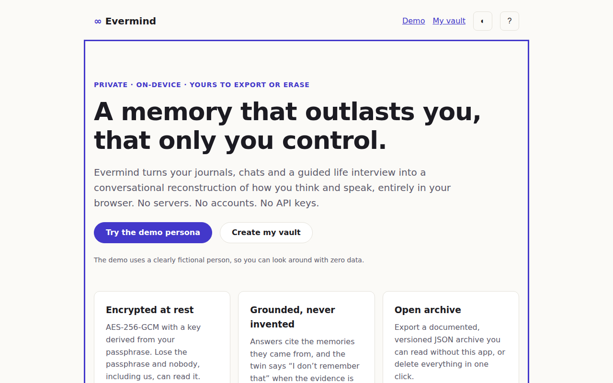
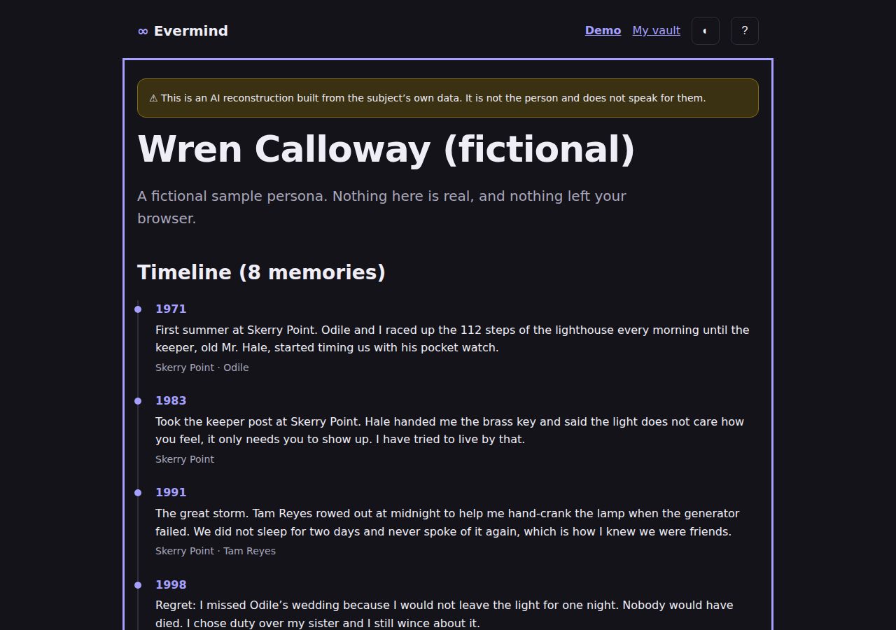
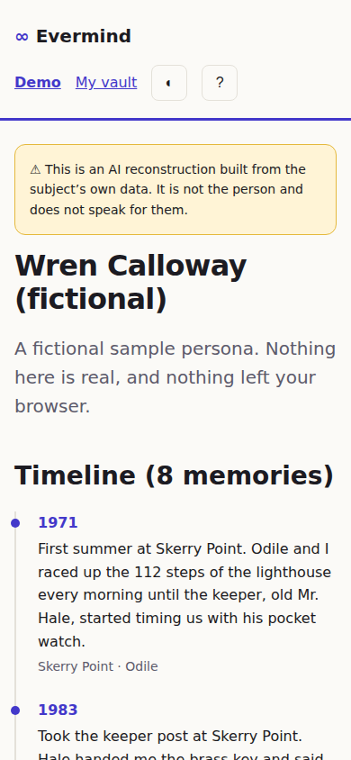
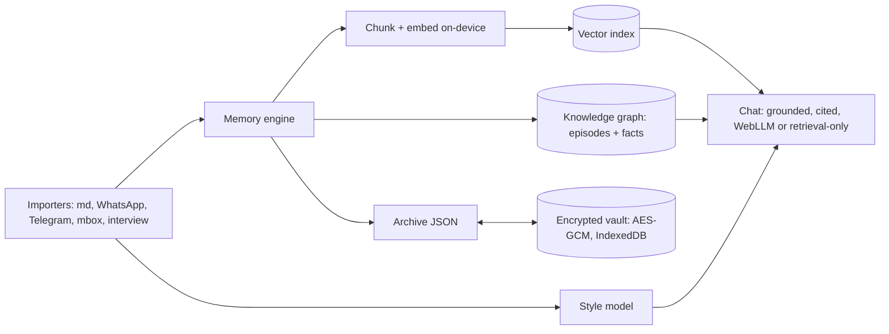

# Evermind

**Live: https://striv11.github.io/evermind/** (demo mode works with no data)

> A private, on-device digital twin and legacy archive: built from your own words, encrypted with your passphrase, and honest about being an AI reconstruction.


| Landing                          | Demo (dark)                     | Phone                          |
| -------------------------------- | ------------------------------- | ------------------------------ |
|  |  |  |

## Problem

People leave behind scattered journals, chat logs and emails that no one can search, converse with, or
trust to stay private. Existing "digital immortality" services require uploading your most intimate
data to someone else's server, and often blur the line between a person and a simulation of them.

## Motivation

Build it the opposite way: everything runs in the browser, no servers, accounts or API keys. Engineering
ideas explored: WebCrypto vault design (PBKDF2 + AES-GCM with header binding and wrong-passphrase vs
tamper discrimination), an open versioned archive format, on-device embeddings and retrieval (transformers.js),
a stylometric voice model, local LLMs via WebLLM/WebGPU, and retrieval-grounded answers that admit
"I don't remember that" instead of inventing.

## Architecture



Key invariants:

- Plaintext never touches storage: only the encrypted `VaultEnvelope` is persisted.
- The key lives only in memory (non-extractable `CryptoKey`) and vanishes on lock or reload.
- Every twin output is labelled an AI reconstruction; the archive requires `aiDisclosure`.
- No network calls except static model-weight downloads.

Layout: `src/archive` (schema + validator), `src/chat` (grounded answers), `src/graph` (fact extraction, graph, layout), `src/style` (stylometric profile, prompt, similarity), `src/vault` (crypto + storage), `src/demo` (fictional persona),
`src/ui` (views, design system), `e2e` (Playwright), `docs/ARCHIVE_FORMAT.md` (spec).

## Setup

Prerequisites: Node 22+.

```bash
npm ci
npm run dev        # http://localhost:5173
bash check.sh      # format, lint, typecheck, unit tests, build
npx playwright install chromium && npm run e2e
```

## Demo

Live: **https://striv11.github.io/evermind/**. Open it, press **Try the demo persona** (a fictional
lighthouse-keeper-turned-beekeeper, "Wren Calloway") to see the timeline and facts. Press **Create my
vault**, choose a passphrase, lock it, and try a wrong passphrase. Keys: `g d` demo, `g v` vault, `t` theme, `?` help.
Status: landing, demo shell, vault and retrieval-grounded chat (quotes and cites your memories, abstains otherwise) are live.

## Design decisions & trade-offs

- **Vanilla TS, no framework**: tiny bundle (7 KB gzip today), nothing to audit but our own code.
- **PBKDF2 first, Argon2-WASM later**: PBKDF2 is built into WebCrypto (zero dependencies); Argon2id is a roadmap upgrade, and the envelope's `kdf` field and `version` allow migration.
- **Verifier in the header**: lets the UI say "wrong passphrase" vs "data tampered"; it gives an offline guess oracle equivalent to the one the ciphertext already provides.
- **Time capsules are app-enforced**, not cryptographic; documented in the format spec.
- **Evals and budgets are tests**: 68 questions on the demo persona report recall@k, grounding and abstention in [docs/EVALS.md](docs/EVALS.md) (`npm run eval:write`); initial JS < 60 KB gzip is checked by `check.sh`, vault unlock < 1.5 s and search < 50 ms at 10k chunks by `npm run bench:budgets`.
- **Embeddings are derived data**, not archived, so the format stays small and model-independent.

## Roadmap

See [PLAN.md](PLAN.md) for the 14-day arc.

- [x] Day 1: scaffold, archive spec + validator, encrypted vault, landing + demo shell
- [ ] Importers, interview, memory engine, style model, chat, legacy exports, evals, polish

## License

MIT. See [LICENSE](LICENSE).
